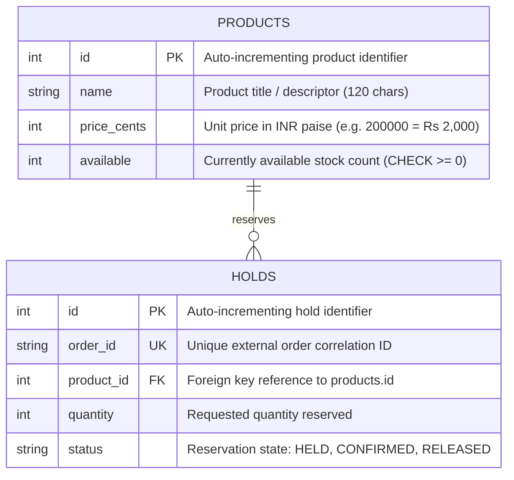
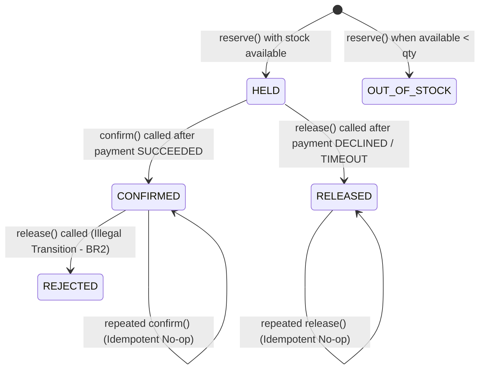

# Inventory Service - Data Model and ER Diagram

**Owner**: Dr. Sunanda Pandita (Inventory Service Lead)  
**Course**: BITS Pilani WILP - Scalable Services (SEZG583)  
**Database**: `inventory_db` (Isolated PostgreSQL database)

---

## 1. Entity-Relationship Diagram



---

## 2. Relational Schema Definitions

### `products` Table
```sql
CREATE TABLE products (
    id SERIAL PRIMARY KEY,
    name VARCHAR(120) NOT NULL,
    price_cents INTEGER NOT NULL CHECK (price_cents > 0),
    available INTEGER NOT NULL CHECK (available >= 0)
);
```

### `holds` Table (Stock Reservations)
```sql
CREATE TABLE holds (
    id SERIAL PRIMARY KEY,
    order_id VARCHAR(64) NOT NULL UNIQUE,
    product_id INTEGER NOT NULL REFERENCES products(id),
    quantity INTEGER NOT NULL CHECK (quantity > 0),
    status VARCHAR(20) NOT NULL DEFAULT 'HELD'
);
```

---

## 3. Hold State Machine



### State Definitions
1. **HELD**: Stock has been conditionally deducted from `available` in an atomic SQL statement and reserved specifically for `order_id`.
2. **CONFIRMED**: Payment succeeded downstream. The stock is permanently allocated to the customer order. Transition to `RELEASED` is permanently blocked (BR2).
3. **RELEASED**: Order was canceled or payment failed. Stock is incremented back into `products.available`. Further attempts to confirm or re-release are safely handled.
