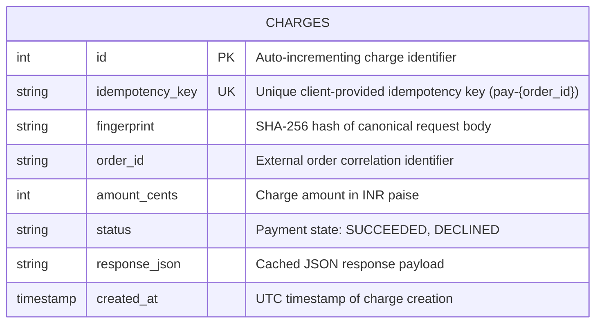
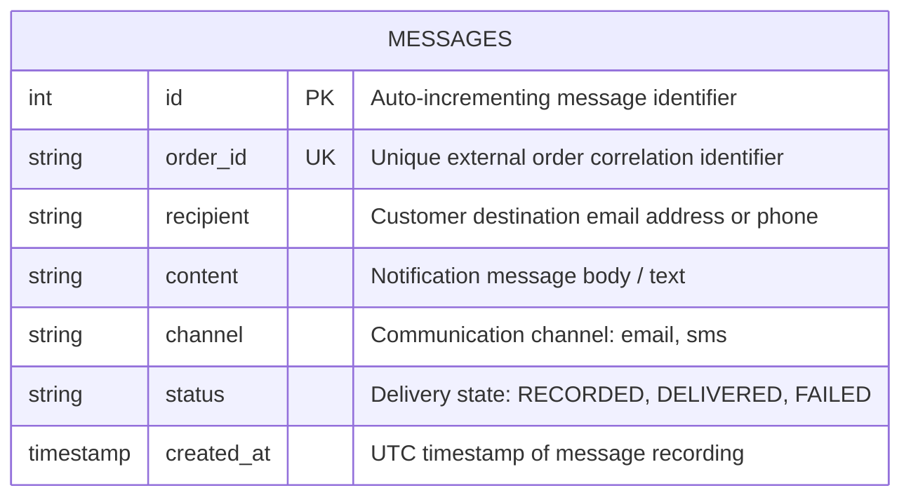
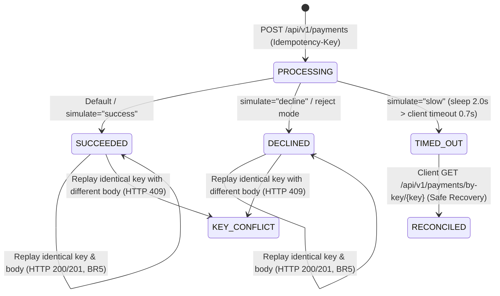
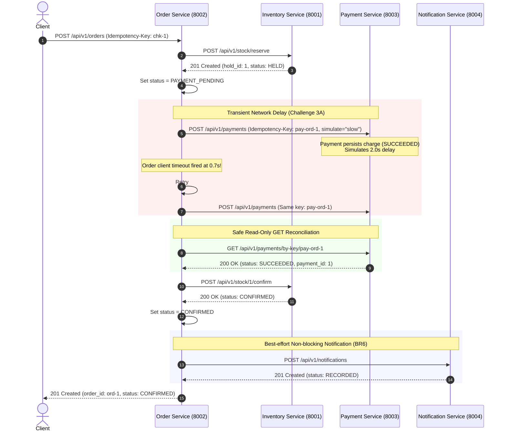

# Payment & Notification Services - Data Model and ER Diagram

**Owner**: Meghana Toutam (Payment & Notification Service Lead)  
**Course**: BITS Pilani WILP - Scalable Services (SEZG583)  
**Databases**: `payment_db` and `notification_db` (Isolated PostgreSQL databases)  

---

## 1. Entity-Relationship Diagrams

### Payment Service Data Model (`payment_db`)



### Notification Service Data Model (`notification_db`)



---

## 2. Relational Schema Definitions

### `charges` Table (`payment_db`)
```sql
CREATE TABLE charges (
    id SERIAL PRIMARY KEY,
    idempotency_key VARCHAR(120) NOT NULL UNIQUE,
    fingerprint VARCHAR(64) NOT NULL,
    order_id VARCHAR(64) NOT NULL,
    amount_cents INTEGER NOT NULL CHECK (amount_cents > 0),
    status VARCHAR(20) NOT NULL,
    response_json VARCHAR(500),
    created_at TIMESTAMP WITH TIME ZONE DEFAULT CURRENT_TIMESTAMP
);

CREATE UNIQUE INDEX ix_charges_idempotency_key ON charges(idempotency_key);
CREATE INDEX ix_charges_order_id ON charges(order_id);
```

### `messages` Table (`notification_db`)
```sql
CREATE TABLE messages (
    id SERIAL PRIMARY KEY,
    order_id VARCHAR(64) NOT NULL UNIQUE,
    recipient VARCHAR(120) NOT NULL,
    content VARCHAR(250) NOT NULL,
    channel VARCHAR(30) NOT NULL DEFAULT 'email',
    status VARCHAR(20) NOT NULL DEFAULT 'RECORDED',
    created_at TIMESTAMP WITH TIME ZONE DEFAULT CURRENT_TIMESTAMP
);

CREATE UNIQUE INDEX ix_messages_order_id ON messages(order_id);
```

---

## 3. Payment Charge State & Idempotency Transition Machine



---

## 4. Challenge 3A Sequence Diagram: Timeout, Retry & Reconciliation


